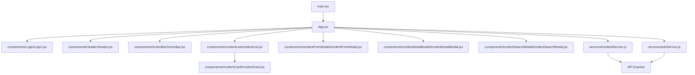
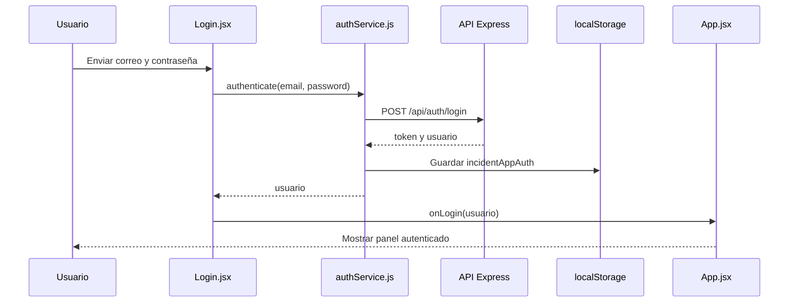
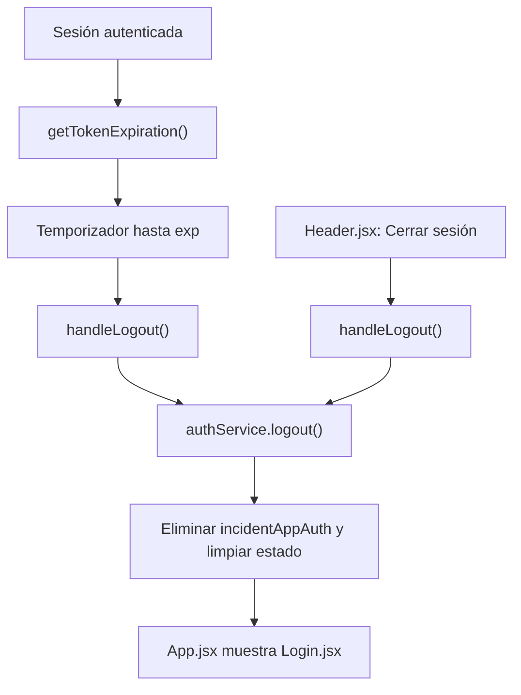
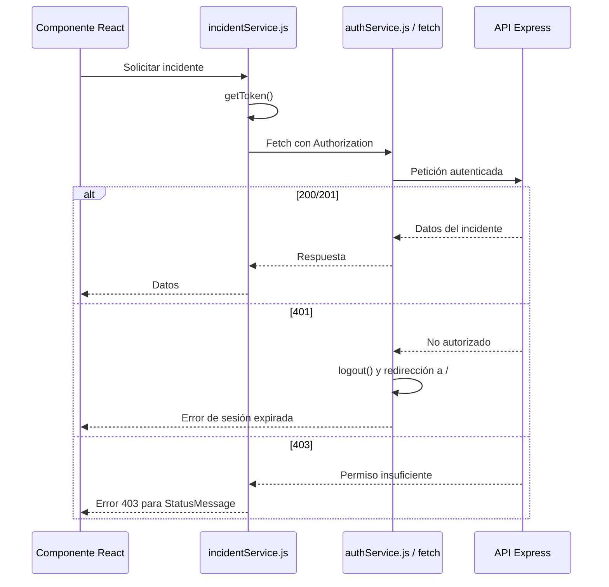
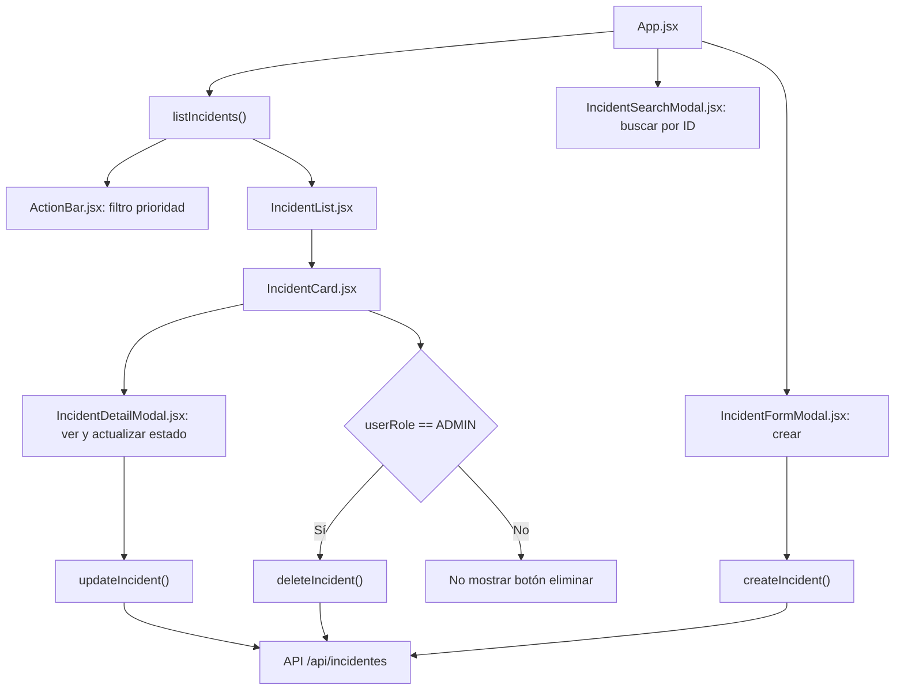

# Frontend de gestión de incidentes

Frontend local de la aplicación de gestión de incidentes. Está construido con
React y consume el backend Express mediante login JWT y operaciones autenticadas
de incidentes.

## Requisitos, instalación y ejecución local

Requiere Node.js 22.x, de acuerdo con el requisito declarado por el backend del
proyecto, y un backend local accesible. Las dependencias se instalan desde
`FrontEnd/`:

```powershell
npm install
npm run dev
```

El servidor de desarrollo de Vite muestra la dirección local al iniciar. El
puerto exacto no está fijado en `FrontEnd/vite.config.js`: **POR CONFIRMAR** si
se requiere un puerto distinto del predeterminado de Vite.

Scripts definidos en `FrontEnd/package.json`:

| Script | Función |
|---|---|
| `npm run dev` | Inicia Vite en modo desarrollo con recarga en caliente. |
| `npm run build` | Genera la compilación del frontend. |
| `npm run lint` | Ejecuta ESLint sobre el frontend. |
| `npm run preview` | Sirve localmente la compilación generada para previsualización. |

No hay un script de pruebas de frontend definido en `package.json`.

## Variables de entorno

El código lee una variable de entorno de Vite:

| Variable | Uso | Respaldo local |
|---|---|---|
| `VITE_API_URL` | Define la base usada por los servicios HTTP del frontend. | `authService.js` usa `http://localhost:3000`; `incidentService.js` usa `http://localhost:3000/api/incidentes`. |

La diferencia entre ambos respaldos se debe a que `authService.js` agrega
`/api/auth/login`, mientras `incidentService.js` trabaja directamente sobre la
ruta `/api/incidentes`. No se documentan valores reales ni variables de
producción.

## Stack tecnológico

- **React 19**: componentes y renderizado de la interfaz.
- **React DOM**: montaje de la aplicación en el elemento `root`.
- **Vite**: servidor de desarrollo y compilación.
- **ESLint**: revisión estática del código JavaScript y JSX.
- **Fetch API**: comunicación HTTP con el backend.
- **CSS**: estilos separados por componente y estilos globales.
- **`localStorage`**: persistencia local de la sesión y del JWT.
- **`<dialog>` nativo**: modales de formulario, detalle y búsqueda.

## Estructura de `src`

```text
src/
├── main.jsx                         Punto de montaje React y StrictMode.
├── App.jsx                          Estado de sesión, lista y operaciones principales.
├── App.css                           Estilos de la vista principal.
├── index.css                         Estilos globales.
├── assets/                           Recursos estáticos; uso concreto: POR CONFIRMAR.
├── components/
│   ├── ActionBar/                    Filtro de prioridad y búsqueda por ID.
│   ├── Footer/                       Pie de la interfaz.
│   ├── Header/                       Rol mostrado, navegación y cierre de sesión.
│   ├── IncidentCard/                 Tarjeta, detalle y eliminación condicional.
│   ├── IncidentDetailModal/          Consulta y actualización del estado.
│   ├── IncidentFormModal/            Formulario de creación.
│   ├── IncidentList/                 Lista, carga y estado vacío.
│   ├── IncidentSearchModal/          Búsqueda de incidente por ID.
│   ├── Login/                        Formulario de autenticación.
│   └── StatusMessage/                Mensajes de éxito y error.
├── hooks/
│   └── statusMessage.js              Hook local para mensajes temporales o de error.
├── services/
│   ├── authService.js                Login, sesión, JWT y tratamiento global de 401.
│   └── incidentService.js            Solicitudes CRUD de incidentes.
└── utils/
    └── incidentUtils.js              Formateo de fechas y etiquetas de prioridad/estado.
```

## Arquitectura

### Capas

- **Vistas y composición:** `App.jsx` decide si muestra `Login` o el panel
  autenticado y coordina las operaciones.
- **Componentes:** `components/` encapsula header, lista, tarjetas, formularios,
  modales, pie y mensajes.
- **Servicios de acceso a API:** `services/` concentra login, almacenamiento de
  sesión y solicitudes de incidentes.
- **Estado:** React `useState`, `useEffect` y `useCallback` mantienen sesión,
  incidentes, filtros, selección, carga y formularios. No hay Context API ni
  biblioteca externa de estado: **POR CONFIRMAR** si se planifica incorporarla.
- **Utilidades:** `incidentUtils.js` traduce enums y formatea fechas.
- **Estilos:** cada componente mantiene su CSS y `App.css`/`index.css` cubren
  la vista y reglas globales.

La aplicación usa componentes controlados: los valores de formularios, filtros y
modales se mantienen en estado React. Los modales usan el elemento nativo
`dialog`, evitando una dependencia adicional.



## Flujos principales

### Inicio de sesión

`Login.jsx` recoge correo y contraseña y llama a `authenticate` en
`authService.js`. Si el backend responde correctamente, el servicio guarda en
`localStorage` el objeto `incidentAppAuth`, que contiene `user`, `token` e
`isAuthenticated`. `App.jsx` actualiza su estado y deja de mostrar el login
para renderizar el panel. No hay una ruta de navegación externa: el cambio se
realiza mediante renderizado condicional.



Con credenciales incorrectas, el servicio obtiene el mensaje del backend y el
formulario lo muestra. No se guarda una sesión válida.

### Cierre automático y cierre por acción del usuario

Después del login, `App.jsx` obtiene la expiración del JWT con
`getTokenExpiration()` y programa un temporizador. Cuando vence, llama a
`handleLogout`, elimina `incidentAppAuth`, limpia los incidentes y vuelve a
mostrar `Login`. El botón `Cerrar sesión` ejecuta el mismo flujo manualmente.



### Solicitud autenticada

`incidentService.js` obtiene el token desde `localStorage` y agrega
`Authorization: Bearer <token>` a las solicitudes de incidentes. Además,
`authService.js` intercepta el `window.fetch` global para solicitudes cuyo
recurso contiene `/api/`; si recibe 401, cierra la sesión, redirige a `/` y
lanza un error de sesión expirada.

Un 403 no activa el cierre automático: `incidentService.js` transforma la
respuesta en un error con el mensaje del backend y el componente que inició la
acción lo muestra mediante `StatusMessage`.



### Incidentes en la interfaz

Al autenticarse, `App.jsx` lista incidentes mediante `listIncidents`. El usuario
puede filtrar por prioridad desde `ActionBar`, buscar un ID desde
`IncidentSearchModal`, abrir el detalle desde `IncidentCard`, crear desde
`IncidentFormModal`, actualizar el estado desde `IncidentDetailModal` y cargar
la siguiente página mediante el cursor.

`IncidentCard.jsx` muestra el botón de eliminar únicamente cuando el rol
normalizado es `ADMIN`. Tanto ADMIN como ANALISTA pueden ver, crear y actualizar
según la interfaz y el contrato del backend. La autorización efectiva no
depende del botón: el backend aplica el permiso de eliminación y responde 403
si el rol no es suficiente.



La lista usa por defecto seis registros y conserva `nextCursor` para cargar más.
El filtro implementado en la interfaz es el de prioridad; aunque el backend
admite también estado, no existe un control de estado en `ActionBar`.

## Seguridad en el cliente

- El JWT y el perfil recibido se guardan en `localStorage` bajo
  `incidentAppAuth`.
- `authService.js` redacta el comportamiento de sesión ante respuestas 401,
  elimina el almacenamiento y devuelve al usuario al login.
- El frontend oculta el botón de eliminar para ANALISTA, pero esto es solo una
  decisión de interfaz. La autorización real se aplica en el backend.
- `localStorage` es accesible por JavaScript; por tanto, una vulnerabilidad XSS
  podría exponer el token. El código no usa cookies HttpOnly: **POR CONFIRMAR**
  si se requiere modificar este diseño.
- No se observan pruebas automatizadas de frontend ni una política adicional de
  renovación del token: **POR CONFIRMAR**.

## Errores y estados de interfaz

- **Carga inicial:** `IncidentList` muestra `Cargando incidentes...`.
- **Lista vacía:** muestra `No hay incidentes para este filtro.`.
- **Éxito:** `StatusMessage` presenta mensajes de operación; los mensajes de la
  vista principal se limpian o desaparecen según el uso de `useFeedback`.
- **Error de API:** `incidentService.js` prioriza detalles de validación,
  `error` o `mensaje`; un error de red se convierte en un mensaje de servidor no
  disponible.
- **401:** se elimina la sesión, se redirige a `/` y se muestra el login.
- **403:** se conserva la sesión y se muestra el error de permiso en el
  componente que inició la operación.
- **Modales:** los formularios conservan sus datos cuando falla la operación;
  el modal de búsqueda permanece abierto si no encuentra el incidente.
- **Estado ocupado:** los botones de crear, buscar y actualizar se deshabilitan
  mientras la operación está en curso.

## Enlaces del proyecto

- [README de la raíz](../README.md)
- [Arquitectura del backend](../docs/ARQUITECTURA.md)
- [Contrato de la API](../docs/API.md)
