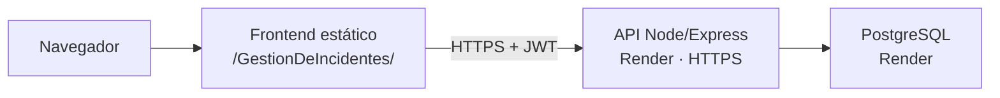

# Arquitectura

## Topología de producción

El frontend React/Vite se compila como sitio estático. La API Express se ejecuta
en Render con `npm start` y se conecta a PostgreSQL mediante Prisma. Las URLs
finales quedan **[POR COMPLETAR TRAS EL DESPLIEGUE: URL del frontend]** y
**[POR COMPLETAR TRAS EL DESPLIEGUE: URL de la API]**.

## Capas del backend

- `src/server.js`: arranque y cierre ordenado.
- `src/app.js`: Helmet, pino-http, CORS, rate limit, JSON, sanitización,
  health checks y routers.
- `src/routes/`: métodos HTTP, validación y permisos.
- `src/controllers/`: parámetros y respuestas.
- `src/services/`: operaciones Prisma y paginación.
- `src/middlewares/`: JWT, autorización por rol, validación y errores.
- `src/schemas/`: contratos Zod.
- `src/config/`: entorno y cliente Prisma.
- `src/utils/`: creación y verificación de JWT.

El frontend organiza la vista principal en `App.jsx`, componentes reutilizables
en `components/`, acceso HTTP en `services/`, estado local en hooks de React y
formateo en `utils/`. No usa router de React: la navegación visible usa anclas
del documento y el cambio entre login y panel es renderizado condicional.

## Producción y seguridad

- `CLIENT_ORIGIN` limita CORS al origen del frontend y `Authorization` está
  permitido explícitamente.
- `app.set("trust proxy", 1)` permite trabajar detrás del proxy de Render.
- El puerto se obtiene de `process.env.PORT` mediante `env.js`, con 3000 como
  respaldo del código.
- En `NODE_ENV=production`, los errores no 4xx se responden como
  `Error interno del servidor`; los logs de pino redactan
  `req.headers.authorization`.
- La conexión Prisma activa SSL explícito solo si el hostname termina en
  `.render.com`, que corresponde a la URL externa; la URL interna no lo activa.
- El plan gratuito puede suspender el servicio cuando está inactivo, por lo que
  la primera solicitud puede tardar más. La disponibilidad exacta del servicio
  es **POR CONFIRMAR** después del despliegue.
- `render.yaml` no ejecuta migraciones: el usuario de aplicación solo tiene
  permisos de CRUD. El esquema debe estar preparado antes de iniciar la API.

## Datos y autorización

`Usuario` tiene correo único, hash, rol y fechas. `Incidente` tiene título,
descripción, responsable, prioridad, estado y fechas. Los roles son `ADMIN` y
`ANALISTA`; solo `ADMIN` puede eliminar. La API protege las rutas de incidentes
con JWT y valida cuerpos con Zod.

## Pendientes de producción

- URLs públicas y comprobación HTTPS: **POR COMPLETAR TRAS EL DESPLIEGUE**.
- Confirmación de la disponibilidad de PostgreSQL y del servicio gratuito:
  **POR CONFIRMAR**.
- El archivo `BackEnd/docker-compose.yml` declara MySQL aunque la aplicación
  usa PostgreSQL; no forma parte de la topología de producción configurada:
  **POR CONFIRMAR** si se conservará como recurso local.
